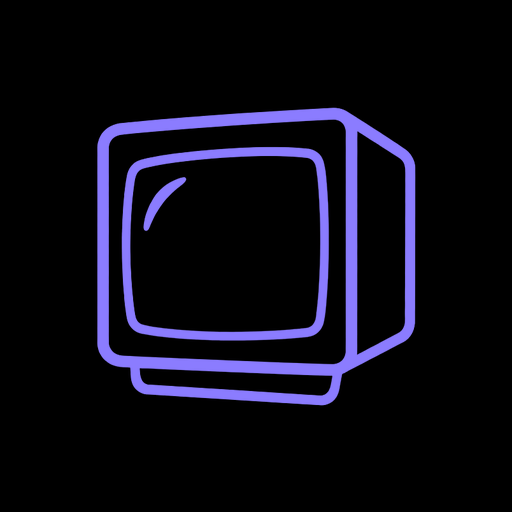

# Cathode

Your subscriptions, auto-downloaded to your NAS, watchable offline on your phone. No Premium, no cellular data, no progress lost on bad Wi-Fi.

- **NAS downloader** (Docker, `server/`): polls your channels, grabs new uploads with **yt-dlp + SponsorBlock**, serves them over your LAN.
- **Android app** (`android/`, a TV station made of your subscriptions): library of downloaded videos, in-app playback, auto-sync the moment you open it.
- **Generic by design**: point `data/subscriptions.opml` or `data/channels.txt` at your channels and it works. No personal data in this repo.

Inspired by [Pinchflat](https://github.com/kieraneglin/pinchflat) (auto-archive + SponsorBlock model) and [TubeArchivist](https://github.com/tubearchivist/tubearchivist) (self-hosted library model). Cathode is the lightweight alternative: single small server + a purpose-built offline-first phone app instead of Plex/Jellyfin + a heavy index.

## How it works

```
YouTube ──poll──▶ server (yt-dlp + SponsorBlock) ──Wi-Fi only──▶ Android app (offline copies on the phone)
  ▲                    │                                  │
  │ subscriptions      │ downloads on server link         │ streams/downloads
  │ (OPML/CSV/txt)     │ the moment videos drop          │ with Range resume
```

1. Server discovers uploads per channel (`yt-dlp --flat-playlist`, RSS-aware) on a schedule **or** when the app asks.
2. Server downloads with resume-safe flags (`--continuedl`, fragment retries, backoff) + SponsorBlock (removes `sponsor,selfpromo,interaction`, marks the rest as chapters so archive jobs stay fast).
3. App syncs **only on unmetered Wi-Fi** (WorkManager `UNMETERED` + runtime check), streams files with HTTP `Range`, and keeps **offline copies as plain .mp4 files** — shared `Movies/Cathode` by default, or any folder you pick (SD card, USB drive). A dropped connection resumes where it stopped — never from zero.

## Quick start (NAS)

```bash
cp .env.example .env
# Put YOUR subscriptions in (pick one; all free, no Premium):
#   data/subscriptions.opml  <- YouTube subscription-manager OPML export, or
#   data/subscriptions.csv   <- Google Takeout (see below), or
#   data/channels.txt        <- one channel URL per line (see channels.example.txt)
./scripts/install-nas.sh
curl -X POST http://<your-nas>:8000/api/subscriptions/refresh
```

Open `http://<your-nas>:8000/api/feed` for your library as JSON, or open
`http://<your-nas>:8000/` in any browser for the web UI. It has the app's
phosphor-tube design and pages: On air (swipe, drag or use ←/→ to change
channel, Enter to watch), the guide, Lineup with import, and Setup with every
server setting plus Stats. The video keeps playing in a mini strip while you
browse, and progress and watch time sync like the phone. There's no offline
sync on the web. The page is plain HTML/CSS/JS in `server/app/static/`, with
no build step.

### Free subscription export (no Premium)

- **OPML (recommended)**: YouTube → Subscriptions → Manage → export, or `youtube.com/subscription_manager`. Save as `data/subscriptions.opml`.
- **Takeout CSV**: [Google Takeout](https://takeout.google.com) → YouTube → Subscriptions → `subscriptions.csv` → save as `data/subscriptions.csv`.
- **Manual**: copy channel URLs into `data/channels.txt`, one per line.

## Android app (Obtainium)

Designed as a TV station made of your subscriptions, on a monochrome green-phosphor tube. There's one phosphor at a few brightness levels on black glass, one terminal typeface (VT323, OFL, bundled in `res/font`), and scanlines over every screen. Emphasis is reverse video (a lit block with dark text), never a second color. Only the picture is in full color: the video and the big screen on On air. Thumbnails in lists are drawn in phosphor. Every channel gets a number (CH 01, CH 02…, alphabetical) that stays the same on every screen.

- **On air**: one big tube showing what to watch next on each channel. Swipe it to change channel; the picture breaks into static as you drag and tunes in as the next channel lands. Under it is the **guide**, one row per channel, where each block is as wide as the video is long. Filters: all, unwatched, on phone. Long-press anything for its menu.
- **Lineup**: the channels you follow, numbered. Ones with nothing on the server right now are listed under *Off air*.
- **Setup**: settings, with terminal-style `ON`/`OFF` toggles and `(*)` radio buttons. **Stats** sits at the top of Setup: watch time (see below), with today on a VCR-style counter, an LED bar chart of the last two weeks and each channel's share of the last 30 days.
- The player shows the channel banner when a program starts, then *Later on this channel* and *Also on air*. While you browse, a now-playing strip sits above the dial.

**Saving to the phone** runs in the background: new uploads are saved after every sync (including the phone's own background sync), and a tapped **Save to phone** keeps going after you close the app. Each library row shows the channel and when the video was uploaded. For saves to run to the end with a progress notification, turn on Settings → **Background downloads** → Allow (this lifts Android's battery optimization for Cathode). Without that, Android stops a background save after about 10 minutes, and it resumes from the same spot next time.

**Stats** (Setup → Stats) shows how long you've actually spent watching: today, the last 7 days, a daily average, all time, a two-week chart and your top channels. Only time spent playing counts (not paused or buffering), and time watched offline is added once the phone is back on Wi-Fi. The web UI's player counts too.

**Comments** sit in a tab beside *Up next* in the player, in the app and on the web. They are the video's top YouTube comments with their replies, fetched by the server when you open the video and kept for 15 minutes. To post or reply, sign in to YouTube once: in the app, Setup → **YouTube account** → Sign in opens Google's own sign-in page; on the web, Setup takes a `cookies.txt` export instead. Either way the session is stored on your server (`data/youtube_account.json`), is used only for posting comments, and is never sent back to a client. Downloads stay anonymous. Anyone who can reach the server can post as that account, which is one more reason to keep it off the public internet.

**Install via [Obtainium](https://apps.obtainium.imranr.dev/)** (update tracking, no store needed): add app → source GitHub → `https://github.com/ieatfood314/cathode` — it picks up each release APK automatically. Or download the APK from the [releases page](../../releases) and install directly.

```bash
cd android && ./gradlew assembleRelease
adb install -r app/build/outputs/apk/release/app-release.apk
```

In the app → Settings → enter your server URL (see Tailscale below), tap **Test connection**, then tune everything in place: polling mode + interval, download quality, SponsorBlock buttons, retention. Changes save to the server as you make them — no SSH or `.env` editing needed day to day. The Channels tab explains how to export your subscriptions and lets you add channels or upload the export file by hand.

## Remote access via Tailscale

The server binds your LAN by default. To reach it from any Wi-Fi (café, work — still never cellular, see below):

```bash
# One-time: share the NAS server on your tailnet over HTTPS
tailscale serve --bg --https=8443 http://127.0.0.1:8000
```

Then in the app → Settings → server URL `https://<your-nas>.<tailnet>.ts.net:8443` → **Test connection**. Wi-Fi-only still applies: Tailscale over Wi-Fi syncs fine; Tailscale over cellular stays paused until you're back on unmetered Wi-Fi.

### Polling controls (Settings)

| Mode | Behavior |
|---|---|
| On app open | NAS only scans when the app opens or you tap sync (`POST /api/subscriptions/refresh`) |
| Periodic | NAS scans every N minutes (you set N); the phone syncs in the background on the same schedule (min 15 on Android) |
| Instant | NAS scans every 5 minutes — new drops land within minutes |

The mode and interval live in Settings → Server config; the server also exposes `PUT /api/settings`.

### Zero cellular, bad-Wi-Fi proof

- **Wi-Fi only**: `NetworkType.UNMETERED` constraints and an `isUnmetered()` runtime gate (covers metered hotspots/VPNs). With the toggle ON, the app throws before any socket opens on cellular.
- **Resume**: server honors `Range` (`GET /api/videos/{id}/stream`), yt-dlp uses `--continue` + fragment retries, app downloads keep a `.part` file and resume with `Range: bytes=<done>-` + exponential backoff — also across failed attempts.
- **Offline library**: the app keeps the last synced library on the phone, so it opens and saved videos play with no network. Where you stopped (and what you finished) is queued and sent on the next sync.

## API

| Method | Path | Notes |
|---|---|---|
| GET | `/api/health` | poll mode, last run |
| GET | `/api/feed?unwatched_only&channel&limit` | library (downloaded videos only) |
| GET | `/api/videos/{id}` | metadata |
| GET | `/api/videos/{id}/stream` | Range-capable file |
| GET | `/api/thumbs/{id}` | thumbnail |
| GET/PUT | `/api/settings` | poll_mode, poll_interval_minutes, resolution, SponsorBlock, keep_days |
| GET | `/api/subscriptions` | parsed inputs + indexed channels |
| POST | `/api/subscriptions/refresh` | starts a background scan, returns immediately (app calls on open) |
| POST | `/api/videos/{id}/progress` | `{"position_seconds": N}`; auto-marks watched near the end, never unmarks |
| POST | `/api/videos/{id}/watched?watched=true` | watch state (`false` also rewinds to the start). With delete-after-watched on, files go `watched_grace_hours` (24) after it's marked, not right away |
| POST | `/api/watchtime` | `{"sessions": [{id, video_id, day, seconds}]}` running totals per video per day; the larger total wins, so resending is safe |
| GET | `/api/stats?since=YYYY-MM-DD` | watch time per day and channel since that date, plus the all-time total |
| GET | `/api/videos/{id}/comments?refresh` | top YouTube comments (a reply has its thread's id in `parent`), cached 15 minutes |
| POST | `/api/videos/{id}/comments` | `{"text": "...", "parent": "<comment id>"}` posts as the signed-in account; `parent` makes it a reply |
| GET/POST/DELETE | `/api/youtube/account` | who comments post as; POST `{"cookies": "..."}` (cookies.txt or a Cookie header) signs in |
| POST | `/api/subscriptions/upload` | `.opml` / `.csv` (replaces that file once it parses) or `.txt` (adds) |

## Privacy / self-host notes

- This repo contains **no personal data**: no IPs, hostnames, usernames, channel lists. `.env`, `data/`, `media/` are gitignored; only `.example` files are committed.
- Server binds LAN only by default; expose via Tailscale/WireGuard, not the public internet.
- YouTube breakage: downloads depend on yt-dlp; update with `docker compose build --pull` when YouTube changes.
- Only archive content you're entitled to keep.

## Upgrading from Ruminate

Cathode was called Ruminate. Existing servers keep working: `RUMINATE_*` env vars are still read (a `CATHODE_*` one wins if both are set), and a `ruminate.db` next to the configured database path is picked up automatically. The Android app has a new package id (`com.cathode.app`), so it installs alongside the old app; re-add it in Obtainium and uninstall Ruminate.
