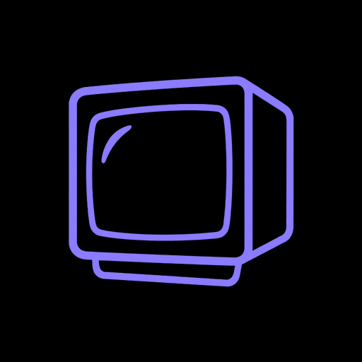

# Cathode

Your subscriptions, auto-downloaded to your NAS, watchable offline on your phone. No Premium, no cellular data, no progress lost on bad Wi-Fi.

- **NAS downloader** (Docker, `server/`): polls your channels, grabs new uploads with **yt-dlp + SponsorBlock**, serves them over your LAN.
- **Android app** (`android/`, OLED black + glass): library of downloaded videos, in-app playback, auto-sync the moment you open it.
- **Generic by design**: point `data/subscriptions.opml` or `data/channels.txt` at your channels and it works. No personal data in this repo.

Inspired by [Pinchflat](https://github.com/kieraneglin/pinchflat) (auto-archive + SponsorBlock model) and [TubeArchivist](https://github.com/tubearchivist/tubearchivist) (self-hosted library model). Cathode is the lightweight alternative: single small server + a purpose-built offline-first phone app instead of Plex/Jellyfin + a heavy index.

## How it works

```
YouTube ──poll──▶ server (yt-dlp + SponsorBlock) ──Wi-Fi only──▶ Android app (offline copies on the phone)
  ▲                    │                                  │
  │ subscriptions      │ downloads on server link         │ streams/downloads
  │ (OPML/CSV/txt)     │ the moment videos drop          │ with Range resume
```

1. Server discovers uploads per channel (`yt-dlp --flat-playlist`, RSS-aware) on a schedule **or** when the app asks.
2. Server downloads with resume-safe flags (`--continuedl`, fragment retries, backoff) + SponsorBlock (removes `sponsor,selfpromo,interaction`, marks the rest as chapters so archive jobs stay fast).
3. App syncs **only on unmetered Wi-Fi** (WorkManager `UNMETERED` + runtime check), streams files with HTTP `Range`, and keeps **offline copies as plain .mp4 files** — shared `Movies/Cathode` by default, or any folder you pick (SD card, USB drive). A dropped connection resumes where it stopped — never from zero.

## Quick start (NAS)

```bash
cp .env.example .env
# Put YOUR subscriptions in (pick one; all free, no Premium):
#   data/subscriptions.opml  <- YouTube subscription-manager OPML export, or
#   data/subscriptions.csv   <- Google Takeout (see below), or
#   data/channels.txt        <- one channel URL per line (see channels.example.txt)
./scripts/install-nas.sh
curl -X POST http://<your-nas>:8000/api/subscriptions/refresh
```

Open `http://<your-nas>:8000/api/feed` — your library as JSON — or just open
`http://<your-nas>:8000/` in a desktop browser for the minimal web UI
(same library, player, and settings as the app; handy on a computer, no
offline sync there).

### Free subscription export (no Premium)

- **OPML (recommended)**: YouTube → Subscriptions → Manage → export, or `youtube.com/subscription_manager`. Save as `data/subscriptions.opml`.
- **Takeout CSV**: [Google Takeout](https://takeout.google.com) → YouTube → Subscriptions → `subscriptions.csv` → save as `data/subscriptions.csv`.
- **Manual**: copy channel URLs into `data/channels.txt`, one per line.

## Android app (Obtainium)

OLED black (`#000000`) + frosted glass cards, bottom-nav Library / Now playing / Settings.

**Install via [Obtainium](https://apps.obtainium.imranr.dev/)** (update tracking, no store needed): add app → source GitHub → `https://github.com/ieatfood314/cathode` — it picks up each release APK automatically. Or download the APK from the [releases page](../../releases) and install directly.

```bash
cd android && ./gradlew assembleRelease
adb install -r app/build/outputs/apk/release/app-release.apk
```

In the app → Settings → enter your server URL (see Tailscale below), tap **Test connection**, then tune everything in place: polling mode + interval, download quality, SponsorBlock buttons, retention. **Save server settings** pushes the lot to the server — no SSH or `.env` editing needed day to day. The Channels tab explains how to export your subscriptions and lets you add channels or upload the export file by hand.

## Remote access via Tailscale

The server binds your LAN by default. To reach it from any Wi-Fi (café, work — still never cellular, see below):

```bash
# One-time: share the NAS server on your tailnet over HTTPS
tailscale serve --bg --https=8443 http://127.0.0.1:8000
```

Then in the app → Settings → server URL `https://<your-nas>.<tailnet>.ts.net:8443` → **Test connection**. Wi-Fi-only still applies: Tailscale over Wi-Fi syncs fine; Tailscale over cellular stays paused until you're back on unmetered Wi-Fi.

### Polling controls (Settings)

| Mode | Behavior |
|---|---|
| On app open | NAS only scans when the app cold-opens / pull-to-refresh (`POST /api/subscriptions/refresh`) |
| Periodic | + background WorkManager sync every N minutes (you set N, min 15 on Android) |
| Instant | Server loop clamped to ≥5 min — new drops land within minutes |

Poll interval slider + server push button live in Settings; server also exposes `PUT /api/settings`.

### Zero cellular, bad-Wi-Fi proof

- **Wi-Fi only**: `NetworkType.UNMETERED` constraints, `isUnmetered()` runtime gate (covers metered hotspots/VPNs), Media3 `Requirements.NETWORK_UNMETERED`. With the toggle ON, the app literally throws before any socket opens on cellular.
- **Resume**: server honors `Range` (`GET /api/videos/{id}/stream`), yt-dlp uses `--continuedl` + fragment retries, app downloads use `.part` + `Range: bytes=<done>-` + exponential backoff. Drops resume fragments; progress is journaled, never discarded.

## API

| Method | Path | Notes |
|---|---|---|
| GET | `/api/health` | poll mode, last run |
| GET | `/api/feed?unwatched_only&channel&limit` | library |
| GET | `/api/videos/{id}` | metadata |
| GET | `/api/videos/{id}/stream` | Range-capable file |
| GET | `/api/thumbs/{id}` | thumbnail |
| GET/PUT | `/api/settings` | poll_mode, poll_interval_minutes, resolution, SponsorBlock, keep_days |
| GET | `/api/subscriptions` | parsed inputs + indexed channels |
| POST | `/api/subscriptions/refresh` | starts a background scan, returns immediately (app calls on open) |
| POST | `/api/videos/{id}/watched?westra=true` | watch state |

## Privacy / self-host notes

- This repo contains **no personal data**: no IPs, hostnames, usernames, channel lists. `.env`, `data/`, `media/` are gitignored; only `.example` files are committed.
- Server binds LAN only by default; expose via Tailscale/WireGuard, not the public internet.
- YouTube breakage: downloads depend on yt-dlp; update with `docker compose build --pull` when YouTube changes.
- Only archive content you're entitled to keep.

## Upgrading from Ruminate

Cathode was called Ruminate. Existing servers keep working: `RUMINATE_*` env vars are still read (a `CATHODE_*` one wins if both are set), and a `ruminate.db` next to the configured database path is picked up automatically. The Android app has a new package id (`com.cathode.app`), so it installs alongside the old app; re-add it in Obtainium and uninstall Ruminate.
